<div align="center">

# CRESCENT

**CRESCENT estimates condition-specific risks of first recorded long-term conditions**

A neural competing-risk model that turns a primary-care diagnosis history into<br>
condition-specific cumulative-incidence estimates, accounting for competing death.

[](#citation)
[](https://doi.org/10.5281/zenodo.24497210)
[](LICENSE)
[](requirements.txt)
[](requirements.txt)

[Manuscript release v1.0.1](https://github.com/dansileshi/crescent/releases/tag/v1.0.1) · [Model details](docs/model.md) · [Comparators](docs/comparators.md) · [Figures](figures/README.md) · [InflAIM codelists](https://github.com/Inflaim-Study/Inflaim-LTC-code-list) · Part of the [InflAIM programme](https://github.com/Inflaim-Study)

</div>

> **Status:** the paper is under review. This repository shares the **full analysis code**: the CRESCENT model, all comparator models, the evaluation, ablation and explanation analyses, and the figure-plotting code. No UK Biobank data, derived data, aggregate result tables or fitted model weights are shared (see [Data and model availability](#data-and-model-availability)).

<p align="center">
  
</p>

---

## Overview

Estimating which long-term conditions (LTCs) will next be recorded requires accounting for competing death and for differences in the information available for each person. CRESCENT uses primary-care diagnosis histories and recruitment covariates to estimate the probability of a **first recorded primary-care diagnosis before death** for each of **58 fitted conditions**, out of 60 prespecified conditions in the [InflAIM framework](https://github.com/Inflaim-Study/Inflaim-LTC-code-list). The two remaining conditions had fewer than 100 training cases and were not fitted.

- **Cohort:** 229,950 UK Biobank participants with linked primary-care records, split by assessment centre.
- **Prediction design:** predictors are fixed at the first recruitment assessment. Each participant–condition pair enters the risk set **six months after recruitment** if the participant is alive, still under observation and has no record of that condition.
- **Competing risk:** death is modelled as a competing event for every condition.

| Evaluation | Years after six-month entry | Months after recruitment |
|---|---:|---:|
| Primary | 2 and 5 | 30 and 66 |
| Secondary | 1 and 10 | 18 and 126 |

A five-year risk is therefore the probability of a first recorded diagnosis between months 6 and 66 after recruitment. Follow-up is limited at the ten-year horizon, so ten-year estimates should be interpreted with caution.

| Partition | Participants | Assessment centres |
|---|---:|---:|
| Training | 161,020 | 14 |
| Validation | 22,962 | 6 |
| Held-out test | 45,968 | 7 |

## Key findings

Held-out test results reported in the paper:

| | CRESCENT | Notes |
|---|---|---|
| Macro AUROC, 2 and 5 years | **0.78** | Tied with the locally pretrained CRESCENT-PT, among nine models |
| 5-year competing-risk concordance (Wolbers) | **0.78** | Best mean rank |
| Largest share of Shapley attribution | Diagnosis history **56%** | Then age 19% and BMI 10% |

At five years, CRESCENT and penalised Cox were within 0.01 AUROC across the ten most common conditions shown in the paper; several rarer conditions showed larger differences favouring CRESCENT (22–101 five-year test events per condition). In the three-seed ablation study, removing event history from the disease rates lowered 60-month macro AUROC by **0.131**, and removing historical event age and reader recency lowered it by **0.080**.

## Repository structure

```
data_preparation/    Builds the prepared splits from UK Biobank records
crescent/            CRESCENT model: config, data, model, train (+ optional ensemble)
comparators/         Eight comparator models, each with the same file layout
evaluation/          Shared test evaluation, bootstrap CIs and figure-input export
ablations/           Table 2: seven configurations x three seeds
explainability/      Figs. 4-5: Shapley values, ALE, diagnosis-removal and look-back analyses
supplementary/       Figs. S2-S4: hyperparameter screen, history sensitivity, scaling
figures/             Fig. 1 overview and plotting scripts for Figs. 2-5
docs/                Model details, input format, comparator descriptions
run_crescent.py      Runs the CRESCENT stages in order
```

| Paper | Code |
|---|---|
| Cohort and data preparation (§2.1–2.3, Table 1) | [`data_preparation/`](data_preparation/) |
| CRESCENT model and training (§2.4–2.5) | [`crescent/`](crescent/) · [docs/model.md](docs/model.md) |
| Comparators (§2.6, Fig. 2) | [`comparators/`](comparators/) · [docs/comparators.md](docs/comparators.md) |
| Evaluation and confidence intervals (§2.7, Figs. 2–3) | [`evaluation/`](evaluation/) |
| History sensitivity and scaling (§2.8, Supplementary Figs. S2–S4) | [`supplementary/`](supplementary/) |
| Explanations (§2.9, Figs. 4–5) | [`explainability/`](explainability/) |
| Architecture ablations (§2.10, Table 2) | [`ablations/`](ablations/) |
| Figures 1–5 | [`figures/`](figures/) |

### What is shared

All analysis code for the paper is shared; only the data and fitted weights are not.

| Area | Code included |
|---|---|
| CRESCENT model, training and evaluation | Full manuscript pipeline |
| Comparator models | All eight comparators (penalised Cox, XGBoost, SurvTRACE-aligned, Dynamic-DeepHit-inspired, MOTOR, Delphi-2M-inspired, Gemma 4 E4B and CRESCENT-PT), with run instructions |
| Ablations, explanations and supplementary analyses | Code for Table 2, Figs. 4–5 and Supplementary Figs. S2–S4 |
| Figures | Figure 1 graphic and plotting code for Figures 2–5, run on your own evaluation outputs |
| Data preparation | Code to build the prepared splits from UK Biobank records |

## Installation

Use the tagged release for the manuscript code:

```bash
git clone --branch v1.0.1 https://github.com/dansileshi/crescent.git
cd crescent
python -m pip install -r requirements.txt
```

The paper used Python 3.11.4 and PyTorch 2.6.0 with CUDA 12.4 on a single GPU. Data preparation used Polars 1.37.1.

## Running CRESCENT

Running the model requires approved UK Biobank access and the prepared `train.csv`, `val.csv` and `test.csv` files built with the data-preparation code. See [docs/model.md](docs/model.md) for the input fields and all settings.

```bash
export CRESCENT_PREPARED_DATA_DIR=/path/to/prepared_splits
export EHR_CRESCENT_FINAL_OUTPUT=runs/CRESCENT_Final     # a new, empty folder
python run_crescent.py                                  # all stages
python run_crescent.py --stages 1-4                     # up to training and checkpoint selection
```

| Stage | File | What it does |
|---|---|---|
| 1 | `crescent/config.py` | Settings, delayed-entry contract, input checks |
| 2 | `crescent/data.py` | Loads the splits, builds targets and dataloaders |
| 3 | `crescent/model.py` | Builds the model |
| 4 | `crescent/train.py` | Trains and selects the checkpoint |
| 5 | `crescent/ensemble.py` | Optional seed ensemble (off by default) |
| 6 | `evaluation/evaluate.py` | Test metrics: AUROC, concordance, Brier, calibration |
| 7 | `evaluation/bootstrap.py` | 200-resample participant bootstrap |
| 8 | `evaluation/export_figure3_inputs.py` | Inputs for Fig. 3 |

The stage files were split directly from the notebook used for the paper and share one Python session, like notebook cells, so run them through `run_crescent.py` rather than importing them. Default settings reproduce the published model configuration.

| Output | Contents |
|---|---|
| `best_model_by_val_loss.pt` | Checkpoint selected by validation loss |
| `training_history.csv` | Training and validation history |
| `test_summary_publication_with_ci.csv` | Held-out performance summaries and confidence intervals |
| `test_per_condition_metrics_with_ci.csv` | Performance by condition and horizon |

All outputs contain or are derived from UK Biobank data. Keep them in approved storage and do not share them outside the terms of your UK Biobank access.

## Data and model availability

- **Code is shared; data and weights are not.** All analysis and plotting code is in this repository. In line with UK Biobank access conditions, it contains no participant-level data, derived datasets, aggregate result tables or fitted model weights. This study used application number **303849**.
- **Reproducing the results** requires approved UK Biobank access ([apply here](https://www.ukbiobank.ac.uk/enable-your-research/apply-for-access)), preparing the data with the provided code and retraining the model.
- **Outcomes** are *first recorded primary-care diagnoses*, not biological onset.
- **Validation** used an internal geographic hold-out within UK Biobank, not an independent external cohort. 94.9% of the cohort was recorded as White.
- **Not a clinical tool.** CRESCENT is a research model and needs evaluation in independent populations before any clinical use.

## Citation

If you use this code, please cite the paper and the [versioned software release](https://doi.org/10.5281/zenodo.24497210):

```bibtex
@article{asfaw2026crescent,
  title   = {CRESCENT estimates condition-specific risks of first recorded long-term conditions},
  author  = {Asfaw, Daniel and Zebin, Tahmina and Khondoker, Mizanur and
             Olaniran, Oyebayo Ridwan and Lewin, Alex and Welch, Ailsa and
             Kulinskaya, Elena and Fox, Chris and MacGregor, Alexander J. and
             Aung, Min Hane},
  journal = {TBC},
  year    = {2026},
  doi     = {TBC}
}
```

Software citation metadata is in [`CITATION.cff`](CITATION.cff).

## Authors

Daniel Asfaw¹, Tahmina Zebin², Mizanur Khondoker¹, Oyebayo Ridwan Olaniran³, Alex Lewin³, Ailsa Welch⁴, Elena Kulinskaya³, Chris Fox⁵, Alexander J MacGregor¹, Min Hane Aung¹

¹ University of East Anglia · ² Brunel University of London · ³ London School of Hygiene and Tropical Medicine · ⁴ Norwich Medical School, University of East Anglia · ⁵ NIHR HealthTech Research Centre, University of Exeter

Contact: Daniel Asfaw (d.asfaw@uea.ac.uk)

## Acknowledgements and funding

This research was conducted using the UK Biobank Resource under application number 303849. We thank the UK Biobank participants and the study team. The work was supported by the National Institute for Health and Care Research (NIHR) through grant NIHR205461 for the InflAIM programme. The views expressed are those of the authors and not necessarily those of the NIHR or the Department of Health and Social Care.

## License

Code is released under the [MIT License](LICENSE).
