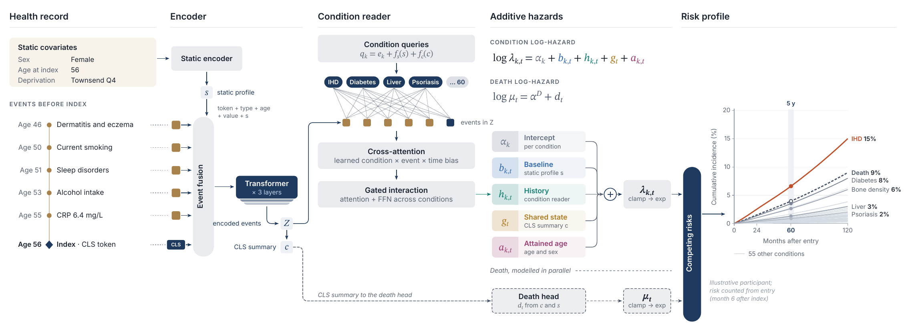

<div align="center">

# CRESCENT

**CRESCENT estimates condition-specific risks of first recorded long-term conditions**

A neural competing-risk model that turns a primary-care diagnosis history into<br>
condition-specific cumulative-incidence estimates, accounting for competing death.

[](#citation)
[](https://doi.org/10.5281/zenodo.24497210)
[](LICENSE)
[](requirements.txt)
[](requirements.txt)

[Model details](docs/model.md) · [Comparators](docs/comparators.md) · [Figures](figures/README.md) · [InflAIM codelists](https://github.com/Inflaim-Study/Inflaim-LTC-code-list) · Part of the [InflAIM programme](https://github.com/Inflaim-Study)

</div>

> **Status:** the paper is under review. Code is being added ahead of publication.

<p align="center">
  
</p>


---

## Overview

Estimating which long-term conditions (LTCs) will next be recorded requires accounting for competing death and for differences in the information available for each person. CRESCENT uses primary-care diagnosis histories and recruitment covariates to estimate, for each of 58 LTCs, the probability of a **first recorded diagnosis before death** within 1, 2, 5 and 10 years.

- **Cohort:** 229,950 UK Biobank participants with linked primary-care records, split by assessment centre into training (161,020; 14 centres), validation (22,962; 6 centres) and held-out test (45,968; 7 centres).
- **Prediction design:** predictors are fixed at recruitment. Each participant–condition pair enters the risk set at **six months** if alive, under observation and free of that condition. Horizons of 12, 24, 60 and 120 months after entry end at recruitment months 18, 30, 66 and 126.
- **Targets:** 60 prespecified conditions from the [InflAIM framework](https://github.com/Inflaim-Study/Inflaim-LTC-code-list). 58 had at least 100 training cases and were fitted.

## Key findings

| | CRESCENT | Notes |
|---|---|---|
| Macro AUROC, 2 and 5 years | **0.78** | Tied with locally pretrained CRESCENT-PT, among nine models |
| 5-year competing-risk concordance (Wolbers) | **0.78** | Best mean rank |
| Scaled integrated Brier skill | **2.3%** | Best mean rank; same as CRESCENT-PT |
| Integrated calibration error | 1.8 × 10⁻³ | Penalised Cox was lower (1.5 × 10⁻³) |
| Largest share of Shapley attribution | Diagnosis history **56%** | Then landmark age 19% and BMI 10% |

In the three-seed ablation study, removing event history from the disease rates lowered 60-month macro AUROC by **0.131**. Removing historical event age and reader recency lowered it by **0.080**.

## Repository structure

```
data_preparation/    Builds the prepared splits from UK Biobank records
crescent/            CRESCENT model: config, data, model, train (+ optional ensemble)
comparators/         Eight comparator models, each with the same file layout
evaluation/          Shared test evaluation, bootstrap CIs and figure-input export
ablations/           Table 2: seven configurations x three seeds
explainability/      Figs. 4-5: Shapley values, ALE, diagnosis-removal and look-back analyses
supplementary/       Figs. S2-S4: hyperparameter screen, history sensitivity, scaling
figures/             Fig. 1 overview and plotting scripts for Figs. 2-5
results/             Aggregate result tables
docs/                Model details, comparator descriptions
run_crescent.py      Runs the CRESCENT stages in order
```

| Paper | Code |
|---|---|
| Cohort and data preparation (§2.1–2.3, Table 1) | [`data_preparation/`](data_preparation/) |
| CRESCENT model and training (§2.4–2.5) | [`crescent/`](crescent/) · [docs/model.md](docs/model.md) |
| Comparators (§2.6, Fig. 2) | [`comparators/`](comparators/) · [docs/comparators.md](docs/comparators.md) |
| Evaluation and confidence intervals (§2.7, Fig. 3) | [`evaluation/`](evaluation/) |
| Architecture ablations (§2.9, Table 2) | [`ablations/`](ablations/) |
| Explanations (§2.8, Figs. 4–5) | [`explainability/`](explainability/) |
| Supplementary Figs. S2–S4 | [`supplementary/`](supplementary/) |
| Figures 1–5 | [`figures/`](figures/) |

Folders other than `crescent/` and `evaluation/` are being filled in ahead of publication.

## Installation

```bash
git clone https://github.com/dansileshi/crescent.git
cd crescent
pip install -r requirements.txt
```

The paper used Python 3.11.4 and PyTorch 2.6.0 with CUDA 12.4 on a single GPU. Data preparation used Polars 1.37.1.

## Running CRESCENT

The model reads prepared `train.csv`, `val.csv` and `test.csv` files built from UK Biobank data, so running it requires approved UK Biobank access.

```bash
export CRESCENT_PREPARED_DATA_DIR=/path/to/splits_229950_one_month_cap
export EHR_CRESCENT_FINAL_OUTPUT=runs/CRESCENT_Final     # a new, empty folder
python run_crescent.py                                  # all stages
python run_crescent.py --stages 1-4                     # up to training only
```

| Stage | File | What it does |
|---|---|---|
| 1 | `crescent/config.py` | Settings, delayed-entry contract, input checks |
| 2 | `crescent/data.py` | Loads the splits, builds targets and dataloaders |
| 3 | `crescent/model.py` | Builds the model |
| 4 | `crescent/train.py` | Trains and selects the checkpoint |
| 5 | `crescent/ensemble.py` | Optional seed ensemble (off by default) |
| 6 | `evaluation/evaluate.py` | Test metrics: AUROC, concordance, Brier, calibration |
| 7 | `evaluation/bootstrap.py` | 200-resample participant bootstrap |
| 8 | `evaluation/export_figure3_inputs.py` | Aggregate inputs for Fig. 3 |

The stage files were split directly from the notebook used for the paper and share one Python session, like notebook cells, so run them through `run_crescent.py` rather than importing them. Default settings reproduce the published model. All settings are listed in [docs/model.md](docs/model.md#settings-environment-variables).

## Redrawing the figures

Figs. 2–5 can be redrawn from the aggregate tables in `figures/figure*/source_data/` without UK Biobank access. See [figures/README.md](figures/README.md).

## Data access and scope

- **Data.** UK Biobank individual-level data cannot be redistributed. Approved researchers can apply through [UK Biobank](https://www.ukbiobank.ac.uk/enable-your-research/apply-for-access). This study used application number **303849**. No participant-level data or trained weights are included here.
- **Outcomes** are *first recorded primary-care diagnoses*, not biological onset.
- **Validation** used an internal geographic holdout within UK Biobank, not an independent external cohort. 94.9% of the cohort was recorded as White.
- **Not a clinical tool.** CRESCENT is a research model and needs external validation before any clinical use.

## Citation

If you use this code, please cite the paper:

```bibtex
@article{asfaw2026crescent,
  title   = {CRESCENT estimates condition-specific risks of first recorded long-term conditions},
  author  = {Asfaw, Daniel and Zebin, Tahmina and Khondoker, Mizanur and
             Olaniran, Oyebayo Ridwan and Lewin, Alex and Welch, Ailsa and
             Kulinskaya, Elena and Fox, Chris and MacGregor, Alexander J. and
             Aung, Min Hane},
  journal = {TBC},
  year    = {2026},
  doi     = {TBC}
}
```

Software citation metadata is in [`CITATION.cff`](CITATION.cff).

## Authors

Daniel Asfaw¹, Tahmina Zebin², Mizanur Khondoker¹, Oyebayo Ridwan Olaniran³, Alex Lewin³, Ailsa Welch⁴, Elena Kulinskaya³, Chris Fox⁵, Alexander J MacGregor¹, Min Hane Aung¹

¹ University of East Anglia · ² Brunel University of London · ³ London School of Hygiene and Tropical Medicine · ⁴ Norwich Medical School, University of East Anglia · ⁵ NIHR HealthTech Research Centre, University of Exeter

Contact: Daniel Asfaw (d.asfaw@uea.ac.uk)

## Acknowledgements and funding

This research was conducted using the UK Biobank Resource under application number 303849. We thank the UK Biobank participants and the study team. The work was supported by the National Institute for Health and Care Research (NIHR) through grant NIHR205461 for the InflAIM programme. The views expressed are those of the authors and not necessarily those of the NIHR or the Department of Health and Social Care.

## License

Code is released under the [MIT License](LICENSE). Aggregate result tables and figures are released under [CC BY 4.0](https://creativecommons.org/licenses/by/4.0/).
